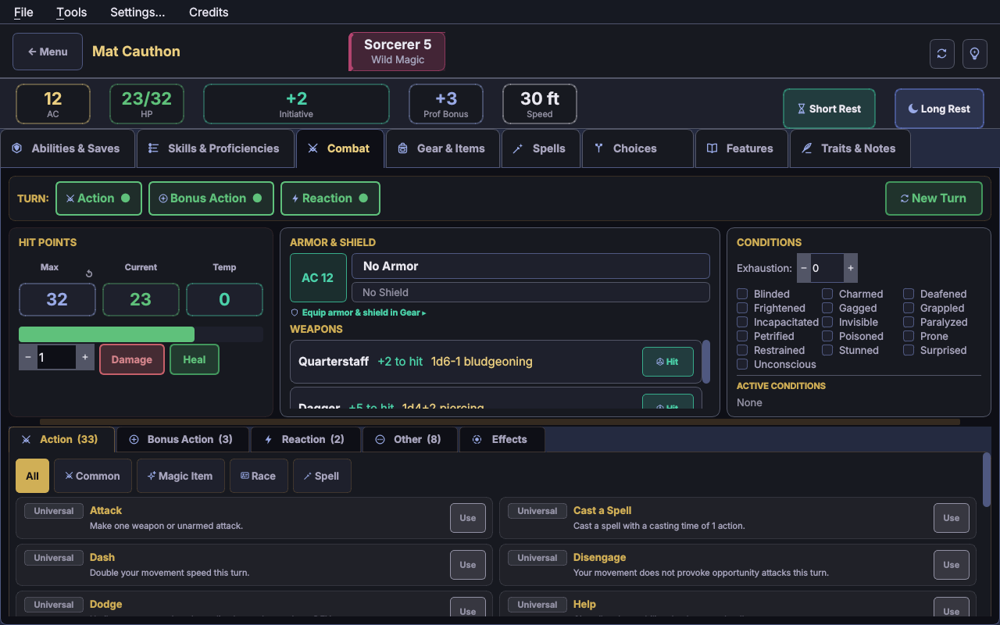
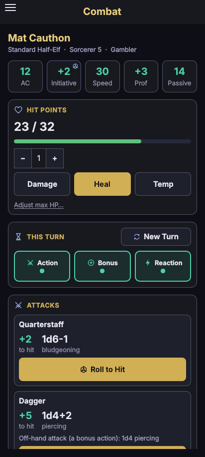
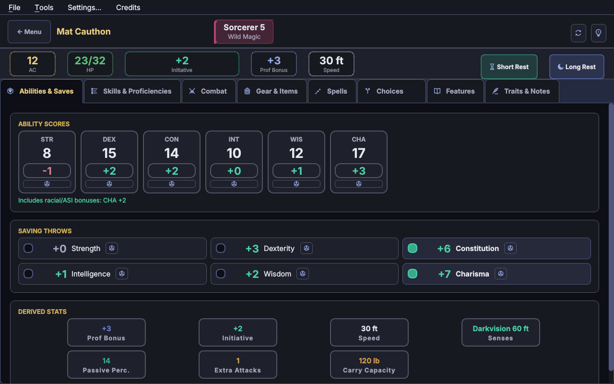
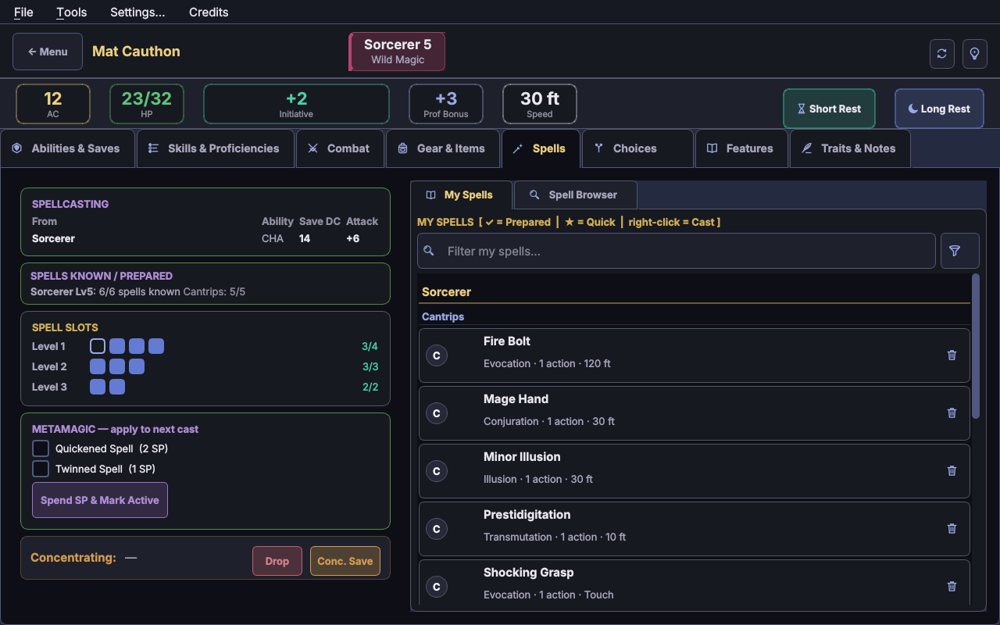
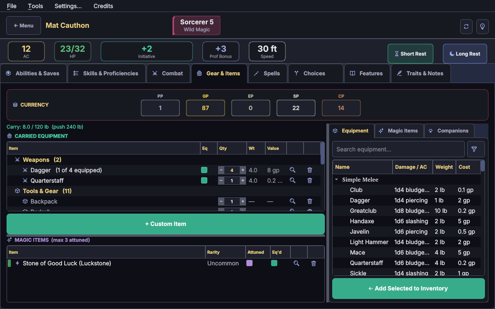
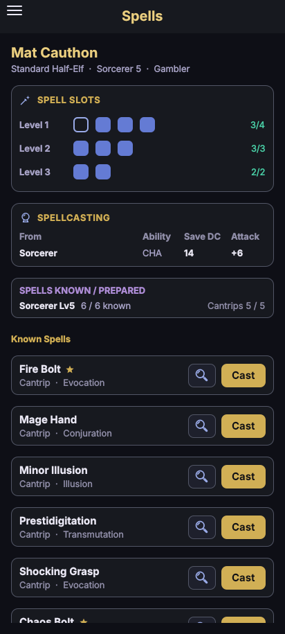
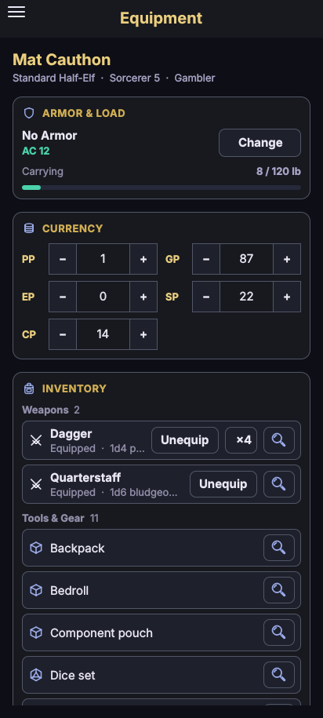

<!-- github-only -->
<p align="center">
  
</p>
<!-- /github-only -->

<h1 align="center">MIMIC</h1>

<p align="center">
  <b>A complete D&D 5e character creator and character sheet</b><br>
  for Windows, macOS, Linux and Android — offline, and free
</p>

<!-- github-only -->
<p align="center">
  
  
  
  
  
</p>

<p align="center">
  
  
</p>

<p align="center">
  <a href="#get-started">Get started</a> ·
  <a href="#using-mimic">Using MIMIC</a> ·
  <a href="#whats-in-it">What's in it</a> ·
  <a href="#screenshots">Screenshots</a> ·
  <a href="#project-layout">Project layout</a> ·
  <a href="#roadmap">Roadmap</a>
</p>
<!-- /github-only -->

Build a character, level it up and play it at the table, on your computer or
your phone, from the same character file. MIMIC keeps the books: slots,
uses, rests, and what every feature, item and condition does to your
numbers. The dice, and your DM's calls, stay with you.

<!-- github-only -->

| 84 | 14 | 127 | 521 | 138 | 99 | 1,283 | 185 |
|:---:|:---:|:---:|:---:|:---:|:---:|:---:|:---:|
| races | classes | subclasses | spells | feats | backgrounds | magic items | Wild Shape forms |

<!-- /github-only -->

- **It keeps count** — spell slots, uses, ki, hit dice and the rest, each back on the right rest
- **Change your mind freely** — level down, swap your race or drop a feat, and everything that came with it goes
- **Bring your old sheets** — a filled-in official 5e PDF character sheet becomes a full character
- **One character, both apps** — the same file opens on your phone and your computer
- **Yours, offline** — no account, no internet, free

---

## Get started

### Run it from source

You need **Python 3.10 or newer**.

```bash
pip install -r requirements.txt
python run_dnd_creator.py
```

### Build it yourself

- **Windows** — `packaging\windows\build_exe.bat` makes `dist\MIMIC.exe`: one file, no Python needed
- **macOS / Linux** — `./packaging/windows/build_exe.sh` makes `dist/MIMIC`
- **Android** — `packaging\android\clean_build_android.bat` makes `dist\MIMIC.apk`, ready to copy to your phone

The guides — [Windows, macOS & Linux](packaging/windows/README.md) and [Android](packaging/android/README.md) — cover first-time setup. The version, **0.3.0**, is set in one place (`dnd_app/ui_android/buildozer.spec`), and both the APK and the Windows EXE (right-click → Properties → Details) carry it.

### Troubleshooting

- **"No module named 'PySide6'"** — run `pip install -r requirements.txt`.
- **The app closes after a while with "deallocating None"** — that's PySide6 6.12.0 on Python 3.11 or older. Run `pip install -r requirements.txt` again (it installs a PySide6 without the fault), or use Python 3.12 or newer.
- **The built program starts and closes straight away** — run it from a terminal to see the error, delete the `build/` and `dist/` folders and rebuild, and check that `dnd_app/ui_desktop/splash/` and `dnd_app/ui_desktop/icon.ico` exist.
- **The splash screen looks frozen** — update to the current source: the startup work runs in the background so the splash keeps moving.

---

## Using MIMIC

<details open>
<summary><b>Your first character</b></summary>

1. Press **Create New Character** on the start screen (or **File → New Character**). The wizard goes race, ability scores (point buy, standard array or your own), background, class, spells and equipment, and shows each option in full as you pick.
2. When it finishes, the sheet opens and the character is saved.
3. Anything the wizard didn't ask — a background's extra skill or tool, a racial language, which ability a feat raises, the spells a feat lets you pick — waits on the **Choices** tab. On Android, the Choices tab pulses until you're done.

Playing a character from paper? **Import PDF Sheet** on the start screen turns a filled-in official character sheet into a full character (see *Saving, sharing and PDFs*).

</details>

<details open>
<summary><b>Finding your way around</b></summary>

| Desktop tab | Android screen | What's there |
|---|---|---|
| Abilities & Saves | Abilities | Scores, saving throws and passive senses. The dice buttons roll; click a save to mark an extra proficiency |
| Skills & Proficiencies | Proficiencies | Skills (right-click one to set proficiency or expertise), languages, armour, weapon and tool proficiencies, and **DM-granted proficiencies…** |
| Combat | Combat, Actions | HP, death saves, weapons, conditions, Wild Shape, everything you can do on a turn, and **New Turn** |
| Gear & Items | Equipment, Companions | Inventory, coins, magic items and attunement, and the Equipment, Magic Items and Companions browsers |
| Spells | Spells | Slots, the Spellcasting table, My Spells and the Spell Browser |
| Infusions | Infusions | Artificers only |
| Choices | Choices | **Level Up / Multiclass**, **Level Down**, **Remove Class**, your identity, and anything still to pick |
| Features | Features | Every class, race and feat feature, and the feats and rewards your DM grants |
| Traits & Notes | Notes | Personality, backstory and notes, and the *Imported from PDF* page |

- **The magnifying glass opens the details** of a spell, item or feat, on both apps.
- **On desktop, right-click a row** for everything else it can do (Cast, Study, Remove…) and hover anything for its numbers. **On Android, press and hold.**
- **Short Rest and Long Rest** sit at the top of the desktop sheet, and in the Android menu.
- In a narrow window the tab names shorten; hover one for its full name.

</details>

<details>
<summary><b>Playing a turn</b></summary>

- **New Turn** gives back your action, bonus action and reaction, ends turn-long effects and resets once-a-turn extras. Until then, a card whose action you've spent is greyed out.
- **Use** (or **Cast**) on a card spends what it costs — a slot, ki, a use — turns its effect on, and says what it did and what's left. When there's a choice to make, it asks.
- **Attacking:** a weapon's **Hit** button (**Roll to Hit** on Android) rolls the d20 and says what AC it hits. Under the roll is what you can add to it, each with its cost: Precision Attack, Lucky, Guided Strike, Emboldening Bond… Press **Add** and it's paid for and rolled at once, and the total updates. **If it misses** lists what can turn a miss around: Favored by the Gods, Stroke of Luck, Focused Aim… Below that is what you can add to the hit: Sneak Attack, a smite, a maneuver… The **Attack** action card asks which weapon first. On a critical hit, the dice shown are already doubled.
- **Damage is your roll.** Every damage line says what to roll and its type; roll it yourself, or open the Dice Roller (Ctrl+D).
- **Advantage and disadvantage are reminders.** Every roll is one d20, with a note of what the sheet knows applies (Reckless Attack, Poisoned, exhaustion…). Roll the second die yourself, since cover, the target and your DM can change it. Advantage you spend something on, like Inspiration, is rolled for you.
- **Taking damage:** type the amount and press **Damage**. Halve it yourself for a resistance; yours are listed just above. Temporary hit points, concentration saves, Wild Shape hit points and death saves follow on their own.
- **Buffs from someone else:** when an ally casts Bless, Guidance, Haste and the like on you, add it on the **Effects** tab (on Android, **Effects on You** on the Combat screen) so its bonuses count. It comes off when its time is up.
- **Conditions** are one click on or off, and show up on the rolls they change.
- **Wild Shape:** the Wild Shape card on the Combat tab lists the forms you can take, strongest first. Anything that needs hands asks before going ahead.
- **Initiative and Inspiration** are at the top of the desktop sheet. Click Initiative to roll it.
- **Before any roll** (check, save, initiative or attack) it asks if there's something to decide first: cast Guidance or Resistance, give yourself advantage (Inspiration, Tides of Chaos, Kenku Recall) or use a Portent roll.
- **Checks, saves and initiative** roll the same way as an attack. What always applies is already counted (Reliable Talent, Bless on a save, Halfling Lucky, Jack of All Trades…). Then each thing you can still add has an **Add** button and its cost: a superiority die, a Bardic Inspiration, your reaction, a use. Press **Done** when you're finished.
- **Tools:** each tool you're proficient with and carry has a card on the **Other** tab that rolls a check with it. It asks which ability, since that's your DM's call, with the usual one first. A Thief's **Fast Hands** card can do the same with your bonus action.
- **Concentration saves** roll themselves on both apps when you take damage. A failed save ends the spell, unless the sheet knows you have advantage on it (War Caster); then your second d20 decides.

</details>

<details>
<summary><b>Spells</b></summary>

- **Preparing:** tick the spell in My Spells. Spells your class, race or a feat gives you are always prepared, and can't be removed.
- **Where to cast:** cantrips and bonus-action and reaction spells always have a card on the Combat tab. A leveled spell that takes an action only shows there once you pin it with ☆ (on Android, press and hold → Add to favourites), so a long spell list doesn't bury your Action tab. Anything slower is cast from My Spells: right-click → Cast, or Cast as Ritual.
- **The Spellcasting table** lists each class, your race and each feat that gives you spells, with its own ability, save DC and attack. A racial spell uses its own row, not your class's.
- **Free casts** from your race or a feat have their own counter, and Cast spends it before a slot. A spell a feat gives at will (Drow High Magic's Detect Magic) never takes one, and Strixhaven Mascot's Find Familiar is cast as a ritual.
- **The Spell Browser** shows the spells on your classes' lists that you can cast now. **Homebrew mode** shows every spell and lifts the limits, if your DM allows it.
- **Spell scrolls** are read with **Use**, from your inventory.

</details>

<details>
<summary><b>Gear, magic items and companions</b></summary>

- **Adding things:** pick a browser on the right of Gear & Items (Equipment, Magic Items or Companions), then double-click a row, or select it and press **Add Selected to Inventory**.
- **Equip** a weapon to give it a Hit button on the Combat tab. **Wear** armour and it goes into your AC.
- **Magic items** only work while they're ticked **Eq'd**, and **Attuned** if they need it. The list's title shows how many you can attune.
- Some items ask a question when you add them: which of your own weapons a +1 goes on, which spell a scroll holds, what damage type a Ring of Resistance guards against.
- **Manuals and tomes:** right-click → Study.
- **Ammunition** comes out of your inventory a shot at a time. Set a magic stack's count from its right-click menu.
- **A mount** from the Equipment browser comes with its stat block, on the Companions tab.

</details>

<details>
<summary><b>Levelling up, and changing your mind</b></summary>

- **Level Up / Multiclass** is on the Choices tab: pick the class to level or add, then make that level's choices.
- **Level Down** and **Remove Class** take a level or a whole class away, with everything it brought: invocations, maneuvers, the spells it alone gave. Level back up and you're asked again.
- Change your race, subrace, background, alignment or a feat later and the same clean-up happens. Anything new to pick waits on Choices (a new alignment asks for Divinely Favored's spell again).
- Your own edits on the Skills tab stay until you press **↺ Reset Manual Changes**.
- **Levelling by XP?** Settings → Advancement → Leveling → Experience Points adds an XP tracker and tells you when you can level. Levelling up is still your click.

</details>

<details>
<summary><b>For DMs and house rules</b></summary>

- **DM-granted proficiencies…** (Skills & Proficiencies): any weapon, armour, tool or language, picked from the list or typed in.
- **The Features tab** grants a feat outside a level-up, with all its rules (its +1 and any spells to pick wait on Choices; Remove takes it all back), or a DM reward: a Character Secret, Supernatural Gift, Dark Gift or replacement background feature.
- **Homebrew mode** in the Spell Browser: learn any spell, with no spells-known limit.
- **A custom race**, in the race list.
- **Table rules**, in Settings and saved with each character: feat prerequisites, multiclass ability requirements, the DMG and Xanathar's optional actions (Disarm, Overrun, Tumble…), maximum hit points every level, component restrictions, and Tasha's optional class features (Eldritch, Martial, Cantrip, Bardic and Sorcerous Versatility, and Harness Divine Power).

</details>

<details>
<summary><b>Saving, sharing and PDFs</b></summary>

- **Characters are saved in `Documents/MIMIC Characters`**, one `.json` file each, with each character's exported sheets in a folder of its own. Settings → Character Folder changes where; on Android it has to be inside Documents or Download.
- **It saves itself** when you create a character, level up or down, or confirm a choice. For anything else, save with **Ctrl+S** (Android: Save & Export → Save). Leaving with unsaved changes asks first.
- **A backup, on desktop:** while you have unsaved changes, a copy is written every minute to `<name>.autosave.json`, next to the character's file. If the app ever closes unexpectedly, rename it to `<name>.json` to get your changes back.
- **Campaign folders:** on the start screen, the folder button on a character moves it into a folder.
- **Between your phone and your computer**, copy the `.json` file across. Open it with **File → Open…** (Ctrl+O), or **Save & Export → Import…** on Android.
- **File → Duplicate Character** (Ctrl+Shift+D) makes a copy to try a different build on.
- **Export** (Ctrl+E): the official character sheet, filled in, as a PDF, or a plain-text summary for your DM. Android can export the character file too.
- **Importing a PDF sheet** (the start screen, or File → Import from PDF Sheet…):
  - only the official 5e sheet works; D&D Beyond's PDF and homemade sheets can't be read
  - it has to be typed in: a scan, photo or handwritten sheet has no text to read
  - a "printed to PDF" (flattened) sheet loses its tick boxes, so proficiencies are worked out from the bonuses; check prepared spells and death saves
  - the sheet only has room for so many spells per level, so any that didn't fit aren't there to bring in
  - anything it can't match is kept, word for word, on an *Imported from PDF* notes page, with a list of things to check

</details>

<details>
<summary><b>Settings</b></summary>

Open them with **Ctrl+,** on desktop, or from the menu on Android.

- **Appearance:** 26 themes (16 dark, 10 light), and the text size (Small, Medium or Large).
- **Immersion:** Immersive Health drains the colour from the sheet as you lose hit points; Immersive Exhaustion closes a dark frame in from the screen's edges with each level of exhaustion. Each is Full, Reduced or Off. The numbers never change, and Reduced never covers any text.
- **Character Folder:** where characters are saved.
- **Saved with each character:** levelling by milestone or XP, the table rules (see *For DMs and house rules*), and **DM Secrets**: purely cosmetic surprises, off by default. Try them and see.

</details>

<details>
<summary><b>Keyboard shortcuts</b> (desktop; ⌘ in place of Ctrl on a Mac)</summary>

| Keys | Does |
|---|---|
| Ctrl+N | New character |
| Ctrl+O | Open a character file |
| Ctrl+S | Save |
| Ctrl+E | Export |
| Ctrl+Shift+D | Duplicate the character |
| Ctrl+D | Dice Roller |
| Ctrl+R | Short Rest |
| Ctrl+Shift+R | Long Rest |
| Ctrl+, | Settings |
| Ctrl+Q | Quit |

</details>

<details>
<summary><b>On Android</b></summary>

- **The menu** has every page of the sheet, plus Short Rest, Long Rest, the Dice Roller, Settings, Save & Export and Credits.
- **Big buttons for what you do often** (Cast, Equip, Drink, Use), a magnifying glass for details, and press and hold for the rest: preparing, favourites, attunement, removing.
- **Favourite a spell** (press and hold → Add to favourites) to cast it from the Combat screen.
- **Holding − or +** on a quantity or an ammunition count changes it by 5.

</details>

---

## What's in it

- **84 races** with their subraces, and a custom race. Where Monsters of the Multiverse reprinted a race, both versions are there
- **14 classes**, Blood Hunter included, with **127 subclasses**
- **521 spells** across all nine levels
- **138 feats** and **99 backgrounds**, from the 2014 rules
- **1,283 magic items**, with their effects working for over 99% of them; the few too situational to automate show as reminders
- **Every standard weapon and armour**, plus silvered and adamantine weapons
- **185 Wild Shape forms**, each with its full stat block: every beast up to CR 6, and the four elementals for a Circle of the Moon druid
- **Companion stat blocks** for the Steel Defender, Wildfire Spirit, Drake Companion, Dancing Item, the Primal Companions, the Eldritch Cannon and mounts
- **One engine, two apps** — desktop and Android build, level and save a character the same way

<!-- github-only -->
## Screenshots

<p align="center">
  
  
</p>
<p align="center">
  
  
  
</p>
<p align="center"><sub>Mat Cauthon, a level 5 Half-Elf Sorcerer (Wild Magic), on desktop and Android.</sub></p>
<!-- /github-only -->

---

## Sources covered

| Category | Sources |
|----------|---------|
| **Core rules** | PHB and DMG (2014) |
| **Supplements** | XGE, TCE, VGM, MTF, MPMM, SCAG, EEPC, FTD, BGG, SatO, BMT, AAG, SAiS |
| **Settings** | ERLW, GGR, EGW, MOT, VRGtR, SCC, DSotDQ, AI |
| **Adventures** | Curse of Strahd, Ghosts of Saltmarsh, Tomb of Annihilation, Baldur's Gate: Descent into Avernus, Icewind Dale: Rime of the Frostmaiden, The Wild Beyond the Witchlight |
| **Smaller releases** | One Grung Above (grung), Locathah Rising (locathah), The Tortle Package (tortle) |
| **Plane Shift** (unofficial) | Amonkhet, Ixalan, Zendikar and Kaladesh races, two Kaladesh backgrounds, and the Amonkhet domains (Ambition, Solidarity, Strength, Zeal) |
| **Others** | A few feats from other publishers: the Tenders' Flamewoken, Forest Sage and Plantmender, and crafting and harvesting feats such as Adroit Crafter and Expert Harvester |

---

<!-- github-only -->
## Project layout

```
dnd_app/
  core/              The rules engine both apps share
    character.py       the character itself, and rests
    builder.py         what race, class, background and feats grant
    calculator.py      AC, saves, skills, HP, slots, speed... (update_all)
    choices.py         what's left to pick, and the clean-up after a change
    actions.py         every action, bonus action and reaction a character has
    action_use.py      what pressing Use on one does
    attacks.py         every attack, its roll and what a hit can add
    checks.py          every d20: checks, saves, initiative, an attack's roll, and what adds to them
    riders.py          the extra damage on a weapon hit, by damage type
    spellcasting.py    spell limits, components, free casts, scrolls
    spell_effects.py   what casting a spell does to your own sheet
    effects.py         buffs, conditions and other active effects
    magic_items.py     item effects, attunement, owned copies
    item_details.py    what an item's details page says, on both apps
    dying.py, ammo.py  damage and death saves; ammunition
    save_load.py       save files, the save folder, old-save upgrades
    pdf_sheet.py       the official 5e PDF sheet, both ways
    readme.py          this file, as both apps' Credits screens show it
  data/              Game data: races, classes, spells, feats, items, stat blocks...
    phb2024/           the 2024 rules' data, for later
    themes.py, icon_data.py, flavor_text.py   shared by both apps' looks
  ui_desktop/        The desktop app (Qt Widgets): pages/, dialogs/, style/
  ui_android/        The Android app (Qt Quick/QML): bridge/, qml/
docs/                The reference lists the game data is checked against
packaging/
  windows/           build_exe.bat / .sh and MIMIC.spec
  android/           the clean build, its one-time setup, p4a_hook.py, icons
run_dnd_creator.py   Desktop entry point
main.py              Android entry point
```

---
<!-- /github-only -->

## Roadmap

- **Clickable cross-references** — a spell, feat or feature named in a description opens its details
- **Monsters and a bestiary** — including the creatures you summon or conjure
- **The 2024 rules** — further off

---

## License

MIMIC is free to use. It is not affiliated with or endorsed by Wizards of the Coast.

D&D 5e content is used under the Open Gaming License (OGL) and/or with permission from Wizards of the Coast.

---

## Credits

**Created by Ethan O'Brien**

**Built with:**
- Python
- PySide6 (Qt), for both the desktop and Android interfaces
- PyInstaller, for packaging the desktop app into a single executable
- Buildozer and python-for-android, for packaging the Android app

Thank you for downloading MIMIC, and for supporting the project.
